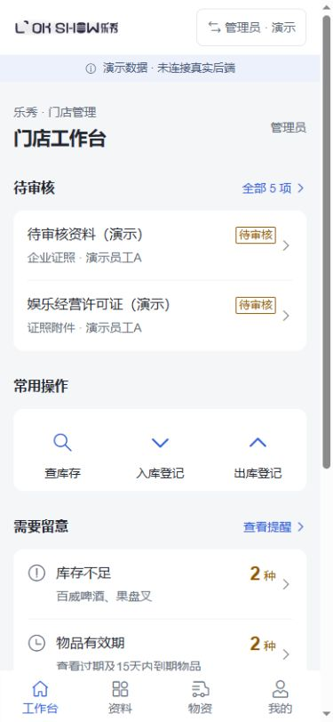
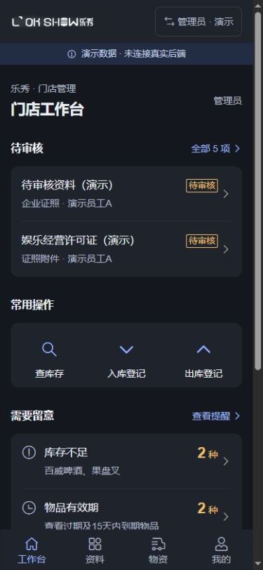
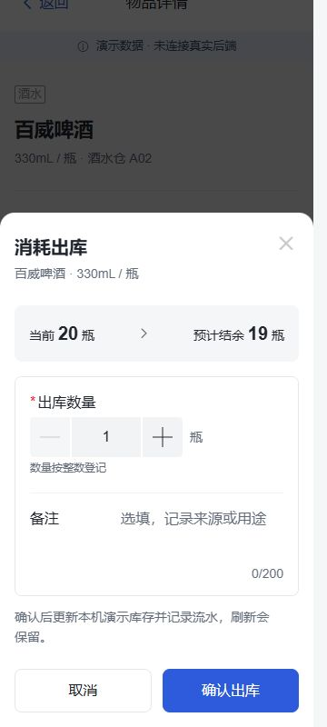

# 前端演示验收说明

验证日期：2026-10-24。结论：可用于页面与操作流程评审，也可交给维护者开展后端对接；尚不能作为门店生产系统。

## 已执行

- `npm run build`：TypeScript 与 Vite 构建通过。
- 构建后的独立预览：仓库、资料、消防、公开酒单主要页面正常，无浏览器告警。
- 24个独立页面入口刷新核对；360/390/430宽度下5类关键页面没有发现横向溢出。
- 实际浏览器：入库及供应商流水、刷新保留、分类盘点差异、员工图片待审/管理员通过、错误文件反馈、资产领还、健康证保存跳详情、PDF附件保存与下载、退回原因、模拟登录与员工管理路径拦截。
- 公开酒单正式大图按钮可前进/返回，首尾禁用正确，关闭后页码同步。
- 消防两张已生效演示样张生成2页A4，渲染检查页面完整；未调用真实打印机。
- 观察的一轮操作中70条请求，没有后端 `/api/` 或非本机HTTP请求。

## 可复跑的隔离回归

`npm run test:demo` 执行七份随包脚本：

| 脚本 | 当前验证 |
|---|---|
| warehouse-store-and-upload-check.cjs | 20组仓库用例、8项上传守卫 |
| warehouse-inventory-form-check.cjs | 20项实际SFC逻辑回归 |
| warehouse-asset-logs-check.cjs | 6项领还流水断言 |
| record-form-router-regression.mjs | 15项实际表单逻辑与memory router回归 |
| drinks-accounts-store-check.cjs | 27项账号与酒单状态断言 |
| drinks-preview-check.cjs | 9项实际脚本/模板、Vue/Vant Button回归；ImagePreview为正式接口替身 |
| reset-storage-check.cjs | 6项真实重置/持久化模块断言；附件边界为Map替身 |

这些脚本隔离浏览器存储、媒体或展示边界，不调用后端，也不能代替真实浏览器/触摸/辅助技术验证。部分脚本会在测试目录生成忽略的结果JSON。依赖按 `package-lock.json` 安装；测试不是后端或生产环境测试套件。

本轮发现并已修复：保存成功被离开守卫拦截、数字转字符串导致空白页误报改动、重置写入失败却清附件、酒单大图缺少鼠标翻页按钮、打印受手机容器宽度限制。修复后执行了针对性回归和交叉复核。

## 视觉截图

下面都是本机演示数据。

日间工作台：

夜间工作台：

360宽度出库表单：

## 尚未验收

真实后端会话与服务端权限、服务器上传、多人并发事务、目标手机/微信、软键盘与安全区、辅助技术完整流程、真实打印机，以及门店人员最终业务/视觉确认。前端角色限制与本机文件保存不构成正式安全和备份方案。
